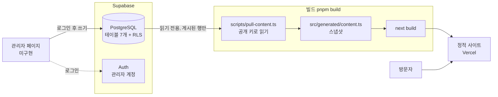
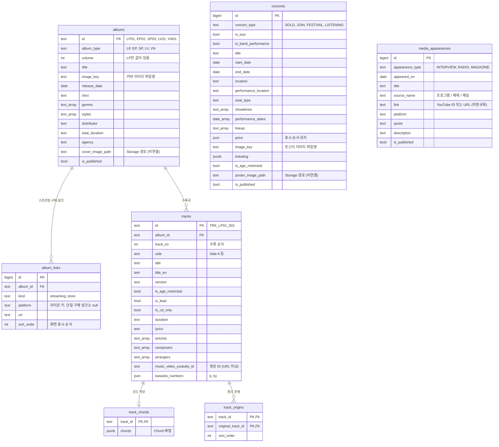

# 백엔드 기술 및 구조

MORTALS LOG의 콘텐츠(앨범·곡·콘서트·출연)를 코드에서 데이터베이스로 옮긴 백엔드의 기술 스택, 구조, 운영 방법을 정리한 문서입니다.

- 기준일: 2026-10-27
- 한 줄 요약: **별도 서버 없이 Supabase(Postgres + Auth)를 백엔드로 쓰고, 공개 사이트는 빌드 시점에 데이터를 받아 정적으로 배포합니다.**
- 스키마를 왜 이렇게 바꿨는지는 [backend-schema-review.md](./backend-schema-review.md)에 있습니다.

## 1. 현재 상태

| 항목 | 상태 | 비고 |
| :-- | :-- | :-- |
| DB 스키마 · RLS | 완료 | 마이그레이션 6개를 원격에 적용 |
| 초기 데이터 | 완료 | 앨범 20 / 링크 124 / 곡 133 / 원곡 관계 42 / 코드 45 / 콘서트 41 / 출연 11 |
| 관리자 계정 | 완료 | 사용자 1명, `app_metadata.role = 'admin'` |
| 관리자 계정 관리 | 코드 완료, **마이그레이션 `20261105090000` 미적용** | 최종 관리자는 계정 추가·삭제, 모든 관리자는 본인 비밀번호 변경·탈퇴. 새 관리자는 초기 비밀번호로 시작해 첫 로그인에서 변경. service_role 키 없이 DB 함수로 처리 |
| 임시 저장 공유 | 코드 완료, **마이그레이션 미적용** | 폼의 "임시 저장"이 `admin_drafts`에 저장되고 모든 관리자가 목록에서 이어서 작성·삭제 (`20261104090000_admin_drafts.sql`). 같은 행의 임시 저장은 하나, 동시 수정은 revision 으로 충돌 감지 |
| 곡 순서 변경 | 코드 완료, **마이그레이션 미적용** | 앨범 관리에서 곡을 ↑↓로 이동. 곡 ID 는 고정 식별자로 두고 position 만 바꾼다 (`20261104090100_track_order.sql`) |
| 비공개(초안) 기능 | 완료 | `is_published`. 원격에서 동작 확인 |
| 프런트 ↔ 데이터 연결 | 완료 | 빌드 시점 스냅샷. 전환 전후 정적 산출물 618개 동일 |
| 관리자 페이지(UI) | 완료(기본) | `/admin`(모바일 지원): 로그인 → 탭(앨범 관리·곡·코드·노래방·MV·공연·출연·계정). 노래방 탭과 MV 탭은 각각 해당 항목이 이미 등록된 곡만 앨범별로 보여주고 확인·수정·삭제(그 항목만 비움, 곡과 다른 항목은 유지), 새 등록은 "+ 곡 추가"로 이미 있는 곡을 골라 목록에 올린 뒤 입력. 바뀐 곡만 한 번에 저장(곡 폼과 같은 규칙, YouTube 주소는 영상 ID로 저장). 목록은 카드 + 검색·정렬·필터. 앨범 관리는 앨범·링크·수록곡을 한 화면에서 등록·수정. 곡 화면에서 원곡 관계도 함께 편집. 목록 카드에서 삭제 가능(확인창, 되돌릴 수 없음) |
| 관리자 수정 → 배포 | 버튼 방식 | 헤더의 "배포하기" → 지금 사이트와 달라지는 내용 확인 창 → 확인 → `POST /api/admin/deploy` → Vercel Deploy Hook. Vercel 환경변수·Hook 등록 후 동작 |
| 이미지 Storage 연결 | 코드 완료, **마이그레이션 미적용** | 관리자 화면이 폴더에서 고른 이미지를 webp 로 올립니다. 원격에 버킷 `images`가 아직 없어 `20261028090000_storage_images.sql` 적용 전에는 업로드가 실패합니다 |

## 2. 기술 스택

| 영역 | 기술 | 역할 |
| :-- | :-- | :-- |
| 데이터베이스 | Supabase 관리형 PostgreSQL | 콘텐츠 저장 |
| 접근 제어 | Postgres RLS + Supabase Auth(JWT) | 읽기 공개(게시된 것만), 쓰기는 관리자만 |
| 클라이언트 | `@supabase/supabase-js` 2.118 | DB 조회·시드 |
| 마이그레이션 | SQL 파일 (`supabase/migrations/`), Supabase CLI 2.122 | 스키마 변경 이력 |
| 스크립트 실행 | `tsx` 4.23 | 시드·스냅샷 생성·검증 (TypeScript 직접 실행) |
| 프런트엔드 | Next.js 15 (정적 생성), TypeScript | 공개 사이트 |
| 배포 | Vercel | 빌드·호스팅 |

별도 API 서버는 없습니다. 이 규모(레코드 수백 개, 월 1회 갱신, 편집자 1명)에서는 관리형 DB와 정적 배포로 충분하다고 판단했습니다.

## 3. 전체 구조



핵심은 **공개 사이트가 런타임에 Supabase를 호출하지 않는다**는 점입니다. 빌드할 때 한 번 읽어서 정적 파일로 굳힙니다.

- 장점: 화면 코드가 바뀌지 않고, 사이트가 DB 상태(무료 플랜의 장기간 미사용 일시정지 등)에 영향을 받지 않으며, 응답이 빠릅니다.
- 단점: 관리자가 수정한 내용은 재배포 후에 반영됩니다(1~2분).

## 4. 데이터 모델



모든 테이블에 `created_at`, `updated_at`(트리거로 자동 갱신)이 있습니다.

### 설계 결정

- **앨범 id는 곡 id 접두사에서 만듭니다.** 원본 데이터에 앨범 id가 없고, 곡이 `TRK_LP01_*` 형태로 앨범을 가리킵니다. 접두사(`LP01`)를 그대로 앨범 id로 썼고, 곡 id는 `TRK_{album_id}_{track_no 3자리}`로 **CHECK 제약이 강제**합니다. id는 불변입니다.
- **`volume`은 정규 앨범(LP)만 씁니다("N집").** EP·싱글·라이브·바이닐의 회차는 id 숫자(`EP01`의 `01`)입니다. CHECK가 "LP일 때만 값이 있다"를 강제합니다.
- **순서가 의미 있는 데이터는 행 + `sort_order`로 둡니다.** 스트리밍·구매 링크(`album_links`)와 원곡 관계(`track_origins`)입니다. 예전에 JSON 객체의 키 순서에 의존했다가 `jsonb`가 순서를 잃어 화면이 달라진 적이 있습니다. 같은 이유로 남아 있는 `price`, `karaoke_numbers`는 `json`(순서 보존)입니다. `chords`, `ticketing`처럼 순서가 무관한 것만 `jsonb`입니다.
- **공연 유형은 세 축으로 나눴습니다.** 형식(`concert_type`: SOLO/JOIN/FESTIVAL/LISTENING) + 투어 여부(`is_tour`) + 밴드 공연 여부(`is_band_performance`). 기존 `TOUR` 3건(천진우 단독 순회)과 `BAND_TOUR` 2건(밴드 5인의 단독 순회)은 형식이 모두 SOLO입니다. 화면은 기존 7개 유형 값을 쓰므로 매퍼가 세 값에서 다시 조합합니다.
- **날짜는 `date` 타입입니다.** 콘서트는 `start_date`/`end_date`, 출연은 `appeared_on`. 화면용 `'09.05 ~ 09.06'` 문자열은 매퍼가 만듭니다(되돌려도 원본과 같음을 확인).
- **`image_key`는 slug가 아니라 이미지 파일명입니다.** 같은 커버를 쓰는 앨범끼리 중복될 수 있습니다(EP와 바이닐이 `tunnel` 공유).
- **콘서트·출연 순서는 `id`(등록 순서)에 의존합니다.** 같은 날짜끼리의 표시 순서가 이 순서를 따르므로 조회 시 `id`로 정렬합니다.
- **정적 설정성 데이터(프로필, 링크, 굿즈 안내 등)는 DB에 넣지 않았습니다.** 코드(아이콘, 함수)와 얽혀 있고 거의 바뀌지 않습니다.

## 5. 접근 제어

| 대상 | 읽기 | 쓰기 |
| :-- | :-- | :-- |
| 방문자 (anon) | **게시된 것만** | 불가 |
| 로그인했지만 관리자 아님 | 게시된 것만 | 불가 |
| 관리자 (`app_metadata.role = 'admin'`) | 비공개 포함 전체 | 가능 |

모든 테이블에 RLS를 켜고 정책을 두 개씩 둡니다(`<테이블>_public_read`, `<테이블>_admin_write`). 쓰기 정책은 `public.is_admin()`을 호출합니다.

```sql
create function public.is_admin() returns boolean
language sql stable set search_path = ''
as $$ select coalesce(auth.jwt() -> 'app_metadata' ->> 'role', '') = 'admin' $$;
```

**왜 "로그인한 사용자"가 아니라 `app_metadata`인가.** Supabase Auth는 기본적으로 회원가입이 열려 있고, 공개 키(anon/publishable)는 브라우저에 노출됩니다. "로그인했으면 쓰기 허용"으로 두면 누구나 가입해서 데이터를 고칠 수 있습니다. `app_metadata`는 사용자가 직접 수정할 수 없고(대시보드·service role만 가능), 그래서 가입자가 스스로 관리자가 될 수 없습니다. 같은 이유로 사용자가 고칠 수 있는 `user_metadata.role`은 신뢰하지 않습니다.

관리자 지정은 대시보드에서 계정을 만든 뒤 SQL로 합니다.

```sql
update auth.users
set raw_app_meta_data = raw_app_meta_data || '{"role":"admin"}'
where email = '<관리자 이메일>';
```

### 비공개(초안) 기능

`albums`, `concerts`, `media_appearances`의 `is_published`가 `false`이면 공개 키로는 보이지 않습니다. 앨범을 숨기면 **그 앨범의 곡·링크·원곡 관계·코드도 함께** 숨겨집니다(소속 앨범의 게시 여부를 따름). 관리자는 비공개 행도 봅니다.

- 빌드가 공개 키로 읽으므로 **비공개 행은 스냅샷과 배포에 들어가지 않습니다.**
- 숨긴 앨범의 곡을 원곡으로 가리키는 다른 곡이 있으면, 매퍼가 끊어진 원곡 id를 자동으로 뺍니다.
- 반영은 다음 빌드 때입니다. 공개했다가 다시 숨기면 다음 빌드에서 사라집니다.

## 6. 데이터 흐름

### 6.1 시드: 코드 데이터 → DB (새 DB를 처음 채울 때)

```
src/const/fixtures/*.ts  →  scripts/seed-rows.ts  →  scripts/seed.ts  →  Supabase
   (손으로 쓴 원본)           (행으로 변환 + 무결성 검사)     (삽입 + 건수 검증)
```

- 기본은 dry-run입니다. `--apply`를 붙여야 원격에 씁니다.
- 대상 테이블에 이미 데이터가 있으면 중단합니다. 관리자 페이지에서 수정한 내용을 덮어쓰지 않기 위해서이고, 전체 교체는 `--force`가 필요합니다.
- 삽입 전에 DB 제약과 같은 규칙으로 무결성을 검사합니다(곡 id 규칙, `volume` 규칙, 원곡 존재, 링크 URL, 날짜의 달력 유효성, 중복 등). 삽입 후 건수를 대조합니다.
- 삽입은 부모 테이블 먼저, `--force` 삭제는 `track_origins`를 먼저 지웁니다(`original_track_id`가 `on delete restrict`).

### 6.2 스냅샷: DB → 정적 파일 (빌드마다)

```
Supabase  →  fetch-content-rows.ts  →  mappers.ts  →  src/generated/content.ts
            (테이블 7개 조회)          (행 → 도메인 객체)     (커밋되는 스냅샷)
```

- 공개(읽기 전용) 키만 씁니다. 쓰기 권한이 필요 없습니다.
- `mappers.ts`는 DB 행을 기존 상수(`FULL_ALBUMS`, `MASTER_TRACKS` 등)와 같은 모양으로 되돌립니다. 링크는 `sort_order` 순서의 `{플랫폼: URL}`로, 날짜는 `'MM.DD'`로, 공연 유형은 기존 7개 값으로 조합합니다. 연도별 그룹핑, 정렬, `'미정'` 기본값, 곡 순서(LP → EP → SP → LV → VN)도 재현합니다.
- 환경변수가 없으면 로컬에서는 경고 후 커밋된 스냅샷을 그대로 씁니다. **Vercel 빌드(`VERCEL=1`)에서는 오래된 스냅샷이 조용히 배포되지 않도록 실패시킵니다.** 앨범·곡이 0건이면 빈 사이트를 배포하지 않도록 역시 실패시킵니다.

### 6.3 화면: 스냅샷 → 컴포넌트

`src/const/{albums,concert,event,tracks,chords}.ts`는 스냅샷을 읽는 얇은 어댑터입니다. export 이름이 이전과 같아서 화면·유틸 코드는 수정하지 않았습니다. 손으로 쓴 원본 데이터는 `src/const/fixtures/`에 보존되어 있고, 시드와 검증에 쓰입니다.

## 7. 저장소 구조

```
supabase/
  config.toml
  migrations/
    20261026135100_init_schema.sql                  테이블 5개
    20261026135200_rls_policies.sql                 RLS + is_admin()
    20261026160000_json_for_ordered_columns.sql     순서가 필요한 컬럼을 json으로
    20261027090000_integrity_and_audit.sql          CHECK 제약, 생성·수정 시각, 컬럼 설명
    20261027090100_structure.sql                    링크·원곡 테이블, 날짜 타입, 공연 유형 분리, 비공개, 이미지 경로
    20261027090200_naming.sql                       이름 정리 (events → media_appearances 등)
scripts/
  seed-rows.ts        fixtures → 행 변환 + 무결성 검사
  seed.ts             행 → Supabase (dry-run 기본)
  pull-content.ts     Supabase → src/generated/content.ts
  verify-mappers.ts   fixtures → 행 → 매퍼 결과가 원본과 같은지 검증
src/
  apis/content/
    fetch-content-rows.ts   테이블 7개 조회
    mappers.ts              행 → 도메인 객체 (그룹핑·정렬·기본값·유형 조합)
  types/content-row.ts      테이블 행 타입 (snake_case)
  generated/content.ts      자동 생성 스냅샷 (직접 수정 금지, 포맷터 제외)
  const/                    스냅샷을 읽는 어댑터 + 라벨 상수
  const/fixtures/           손으로 쓴 원본 데이터 (시드·검증용)
```

## 8. 환경변수

`.env.local`에 둡니다(`*.local`은 gitignore 대상).

| 이름 | 공개 여부 | 용도 |
| :-- | :-- | :-- |
| `NEXT_PUBLIC_SUPABASE_URL` | 공개 | 프로젝트 주소 |
| `NEXT_PUBLIC_SUPABASE_PUBLISHABLE_KEY` | 공개 | 읽기 전용. 스냅샷 생성(`pull-content`)에 사용 |
| `SUPABASE_SERVICE_ROLE_KEY` | **비공개** | 시드 전용. RLS를 우회하므로 로컬에서만 쓰고 커밋·배포 환경에 넣지 않음 |

| `VERCEL_DEPLOY_HOOK_URL` | **비공개** | 관리자 페이지의 배포 버튼이 서버(`/api/admin/deploy`)에서 호출하는 Vercel Deploy Hook 주소. 주소를 아는 사람은 누구나 빌드를 일으킬 수 있으므로 `NEXT_PUBLIC_` 접두사를 붙이거나 커밋하지 않음 |

Vercel에는 URL, 공개 키, `VERCEL_DEPLOY_HOOK_URL` 세 개를 등록합니다. `SUPABASE_SERVICE_ROLE_KEY`는 등록하지 않습니다.

## 9. 운영 절차

### 처음 세팅

1. Supabase 프로젝트를 만들고 `supabase/migrations/`를 **파일명 순서대로** 적용합니다. CLI로 적용했다면 `supabase db push`, SQL Editor로 적용했다면 아래 "마이그레이션 이력" 참고.
2. `.env.local`에 환경변수를 넣습니다.
3. `./node_modules/.bin/tsx scripts/seed.ts --apply`로 시드합니다.
4. 관리자 계정을 만들고 5장의 SQL로 권한을 부여합니다.

### 콘텐츠를 수정하거나 공개 여부를 바꿨을 때

1. 관리자가 `/admin`에서 데이터를 추가·수정합니다(탭별 목록 → 수정/+ 추가). 새로 추가하는 앨범·공연·출연은 **비공개로 시작**하니, 사이트에 내보낼 준비가 되면 "공개"를 체크합니다. Supabase 대시보드에서 직접 고쳐도 됩니다.
2. 화면은 DB를 실시간으로 읽지 않고 **스냅샷(`src/generated/content.ts`)을 읽습니다.** DB를 고친 뒤에는 스냅샷을 갱신해야 합니다.
   - `pnpm dev`: **시작할 때마다** 스냅샷을 갱신합니다. 개발 서버가 이미 떠 있다면 다시 시작하거나, 다른 터미널에서 `pnpm pull:content`를 실행합니다(파일이 바뀌면 개발 서버가 다시 읽습니다. 반영이 안 보이면 새로고침).
   - `pnpm build`: 빌드 전에 자동으로 갱신합니다.
3. 배포(빌드)하면 사이트에 반영됩니다. `/admin`에 로그인해 **배포하기** 버튼을 누르면 됩니다(1~2분).

> 스냅샷 갱신은 **게시된(`is_published`) 행**만 가져오고, 앱이 쓰지 않는 컬럼(`cover_image_path` 등)은 화면에 나타나지 않습니다. DB에서 고쳤는데 안 보이면 이 두 가지를 먼저 확인하세요.

### 스키마를 바꿀 때

`supabase/migrations/`에 **새 파일**을 추가합니다. 이미 적용한 파일은 수정하지 않습니다. 컬럼이 늘면 `src/types/content-row.ts`, `scripts/seed-rows.ts`, `src/apis/content/mappers.ts`를 함께 고칩니다. 반드시 아래 검증을 다시 돌립니다.

### 마이그레이션 이력

SQL Editor로 적용해서 Supabase CLI는 적용 사실을 모릅니다. CLI로 `supabase link` 한 뒤 `db push` 하기 전에 한 번 실행해야 합니다. 안 하면 "relation already exists"로 실패합니다.

```bash
pnpm exec supabase migration repair --status applied 20261026135100 20261026135200 20261026160000 20261027090000 20261027090100 20261027090200
```

## 10. 검증

| 확인 항목 | 방법 | 결과 |
| :-- | :-- | :-- |
| 변환 로직이 원본과 같은가 | `scripts/verify-mappers.ts` (원본 → 행 → 매퍼 → 원본과 비교, 중첩 레코드의 키 순서 포함) | 8/8 통과 |
| 마이그레이션이 실제 데이터를 손실 없이 옮기는가 | 원격 v1 데이터를 로컬 Postgres에 넣고 새 마이그레이션 3개로 제자리 변환 → 매퍼 → 원본과 비교 (일회성) | 통과. 빈 DB에 새 시드로 채운 결과와도 동일 |
| 제약·RLS·비공개가 동작하는가 | 로컬 Postgres에서 38개 항목, 실제 Supabase에서 12개 항목 (일회성) | 38/38, 12/12 통과 |
| 마이그레이션 후 스냅샷이 그대로인가 | 새 구조의 원격에서 `pull:content` 재실행 | 스냅샷 파일 **바이트 단위 동일** |
| 전환 전후 화면이 같은가 | 원본 코드 빌드 vs 새 구조 빌드의 정적 산출물(html + rsc)을 빌드 ID·청크 번호를 정규화해 비교 | 618개 전부 동일 |
| 타입·빌드 | `tsc --noEmit`, `next build` | 에러 0건 / 성공 |

`assert.deepStrictEqual`은 객체 키 순서를 비교하지 않아서 `jsonb` 순서 문제를 잡지 못했고, 빌드 산출물 비교에서 발견했습니다. 그래서 순서가 의미 있는 필드(`store`, `streaming`, `price`, `singing`)는 `verify-mappers.ts`가 키 목록을 따로 비교합니다. 로컬 Postgres·원격 검증 스크립트는 저장소에 넣지 않았습니다.

## 11. 설계 결정과 트레이드오프

| 결정 | 대안 | 이유 |
| :-- | :-- | :-- |
| Supabase 사용, 별도 서버 없음 | NestJS/Hono + Prisma 직접 구현 | 이 규모에 서버를 직접 운영하는 건 과합니다. 서버 개발·배포 비용 없이 DB, 인증, 권한을 얻습니다. |
| 빌드 시점 스냅샷 | 런타임 fetch + ISR | 기존 화면이 모듈 로드 시점에 계산되는 동기 상수(`SLUG_TO_TRACK_ID`, `GetTrackToAlbumMap()` 등)에 기대고 있어, 런타임 fetch는 화면·유틸 약 20개를 다시 짜야 합니다. 스냅샷은 어댑터 5개만 바꿉니다. 사이트가 DB 상태에 의존하지 않는 이점도 있습니다. |
| 쓰기 권한을 `app_metadata` 관리자로 제한 | 로그인 사용자 전체 허용 | 5장 참고. 가입이 열려 있으면 누구나 쓸 수 있게 됩니다. |
| 순서 있는 데이터는 행 + `sort_order` | JSON 키 순서 | `jsonb`가 순서를 잃어 화면이 바뀐 적이 있습니다. 관리자 화면에서 순서 변경도 일반 행 편집이 됩니다. |
| 마이그레이션 안에서 데이터 변환 | 재시드 | 관리자 수정이 생겨도 같은 방식으로 안전하게 변환할 수 있고, 삭제 없이 끝납니다. |
| 원본 데이터를 `fixtures/`에 보존 | 삭제 | 시드 재현과 검증에 쓰입니다. DB가 원본이 된 뒤 확신이 서면 지워도 됩니다. |
| 스냅샷을 커밋 | 커밋하지 않고 빌드 때만 생성 | 환경변수가 없는 곳(로컬, Storybook/Chromatic)에서도 빌드가 됩니다. |

## 12. 알려진 제약과 남은 일

1. **관리자 페이지는 기본 기능만 있습니다.** 목록·추가·수정·삭제, 이미지 업로드, 배포 전 변경 확인이 되고 순서 드래그는 없습니다. 삭제는 목록 카드의 "삭제"로 하며 확인창을 거치고 되돌릴 수 없습니다(앨범을 지우면 수록곡·링크·코드·원곡 관계가 함께 지워지고, 다른 곡의 원곡으로 쓰이는 곡이 있으면 막힙니다. 올려 둔 이미지 파일은 Storage에 남습니다). 앨범 화면에서는 저장된 곡을 지울 수 없으니 목록의 곡 탭에서 지우거나 앨범을 비공개로 숨기십시오. 배포 전 확인은 바뀌는 항목의 요약이며 실제 페이지 미리보기는 아닙니다. 비교 기준은 마지막 빌드 때 저장한 `src/generated/content-rows.json`(공개 행 스냅샷)이라, 빌드(`pnpm pull:content`)가 돌아야 갱신됩니다. 장르·플랫폼·작사자 등 "기타"로 입력한 값은 저장하면 다음부터 드롭다운에 나타납니다(별도 목록 테이블은 없고 기존 데이터에서 모읍니다). "앨범 한 번에 등록"은 앨범→링크→곡 순으로 넣고 중간 실패 시 앨범을 지워 되돌립니다(링크·곡은 연쇄 삭제). 테이블별 필드 설정은 `src/views/Admin/admin-tables.ts`입니다. 컬럼을 추가하는 마이그레이션을 만들면 이 파일에도 필드를 추가해야 편집 화면에 나타납니다.
2. **자동 배포는 하지 않습니다.** 수정 후 배포 버튼을 눌러야 반영됩니다. 누르기 전에는 사이트가 이전 상태입니다. 배포 요청에는 호출 제한이 없으니, 연달아 누르면 빌드가 여러 번 쌓입니다.
3. **Vercel 설정이 필요합니다.** 환경변수 3개(URL, 공개 키, `VERCEL_DEPLOY_HOOK_URL`)를 등록하고 Deploy Hook을 만들기 전에는 배포 빌드가 의도적으로 실패하고 배포 버튼도 동작하지 않습니다. `vercel.json`의 옛 `/(.*)` → `/index.html` 리라이트가 `/api/*`에 영향을 주지 않는지 첫 배포 때 확인하세요.
4. **이미지는 두 경로를 함께 씁니다.** 관리자가 올린 이미지는 Storage 경로(`cover_image_path`, `poster_image_path`)가 우선이고, 값이 없으면 `public/images`의 파일명 규칙(앨범 `종류_연도_영어이름.webp`, 공연 `형식_날짜.webp`)을 씁니다. 같은 경로를 다시 올리면 덮어쓰며 브라우저 캐시가 최대 1시간 남을 수 있습니다. 콘서트 포스터 2개(`JOIN_20261114`, `LISTENING_20260423`)는 파일이 없습니다.
5. **미결 정리 항목.** `media_appearances.link`는 플랫폼에 따라 YouTube ID이거나 URL입니다(정규화 미정). 크레딧은 아직 앨범 소개글 안에 있습니다. 가격·예매·코드 악보의 JSON 구조화, 재생시간 정수화는 필요할 때 진행합니다(스키마 점검 문서 참고).
6. **데이터 확인 필요.** `LV01` 총 재생시간이 곡 합계와 2분 차이나고, 곡 길이가 비어 있는 곡이 5곡 있습니다.
7. **시드는 한 번만.** 이미 데이터가 있는 DB에 `seed.ts --apply --force`를 실행하면 콘텐츠 전체가 교체됩니다. 관리자 수정이 생긴 뒤에는 실행하지 마세요.
8. **개발 환경 주의.** 홈 디렉터리(`/Users/hyu`)에 별도 pnpm 프로젝트(`pnpm-workspace.yaml`)가 있어, 레포에서 `pnpm add` 등을 실행하면 홈이 워크스페이스 루트로 잡혀 락파일을 무시하고 의존성이 다시 풀립니다. 패키지를 추가하거나 락파일을 갱신할 때는 `--ignore-workspace`를 붙이세요.

## 관리자 계정 관리

권한 정보는 `auth.users.raw_app_meta_data`에 있어서 사용자가 직접 바꿀 수 없습니다.

| 구분 | 값 | 할 수 있는 일 |
| :--- | :--- | :--- |
| 관리자 | `role = 'admin'` | 콘텐츠 수정·이미지 업로드·배포, **본인** 비밀번호 변경·탈퇴 |
| 최종 관리자 | `role = 'admin'` + `super = true` | 위에 더해 관리자 계정 **추가·삭제** |
| 비밀번호 변경 전 | `must_change_password = true` | 아무것도 할 수 없음 (`is_admin()`이 거짓). 비밀번호를 바꾸는 화면만 보임 |

**규칙**

- 비밀번호는 본인만 바꿉니다. 최종 관리자도 다른 사람의 비밀번호를 바꿀 수 없고, 권한을 부여·해제하는 기능도 없습니다.
- 최종 관리자가 계정을 추가하면 모든 새 관리자가 **같은 초기 비밀번호**로 만들어집니다. 새 관리자는 첫 로그인에서 비밀번호를 바꿔야 하고, 바꾸기 전에는 DB도 관리자로 인정하지 않습니다. 목록에 "초기 비밀번호 미변경"으로 표시됩니다.
- 모든 관리자는 "내 계정" 탭에서 비밀번호를 바꾸거나 탈퇴할 수 있습니다. 탈퇴는 현재 비밀번호를 다시 입력해야 하고, 마지막 최종 관리자는 탈퇴할 수 없습니다.
- 비밀번호를 잊으면 로그인 화면의 "비밀번호 찾기"로 재설정 메일을 받습니다.
- 목록에는 이메일과 권한만 보입니다 (가입일·마지막 로그인은 보이지 않음).

**왜 DB 함수인가.** 계정을 만들고 고치는 일은 원래 `service_role` 키가 필요합니다. 이 키를 Vercel에 두지 않는 원칙을 지키려고, 호출자를 DB에서 직접 확인하는 함수(`security definer`)로 처리합니다. 함수는 로그인한 사용자만 실행할 수 있고, 최종 관리자 전용 함수는 안에서 다시 확인합니다.

**적용 순서**

1. `20261103090000_admin_accounts.sql`, 이어서 `20261105090000_admin_self_service.sql`을 적용합니다 (SQL 편집기에 파일 **내용**을 붙여 넣거나 `supabase db push`).
2. 최종 관리자를 한 번 지정합니다 (이메일만 바꿔서 실행).

```sql
update auth.users
set raw_app_meta_data = coalesce(raw_app_meta_data, '{}'::jsonb) || '{"role":"admin","super":true}'::jsonb
where email = '<최종 관리자 이메일>';
```

3. 초기 비밀번호를 정합니다. 사이트 코드에는 두지 않고 `admin_settings`에만 둡니다. API로는 읽을 수 없고 최종 관리자가 계정을 추가할 때만 화면에 보입니다. 바꾸려면 같은 SQL을 다시 실행합니다 (이미 만든 계정에는 영향 없음).

```sql
insert into public.admin_settings (key, value)
values ('initial_password', '<8자 이상의 초기 비밀번호>')
on conflict (key) do update set value = excluded.value;
```

4. 로그아웃했다가 다시 로그인하면 "계정 관리" 탭이 나타납니다.
5. **초기 비밀번호 메일.** 계정을 추가하면 Supabase가 보내는 "가입 확인" 메일에 초기 비밀번호를 넣어 새 관리자에게 보냅니다. Supabase 대시보드 → Authentication → Emails → **Confirm signup** 템플릿 본문에 아래 문단을 넣으십시오 (제목과 나머지는 그대로 둡니다).

```html
<p>Mortals Log 관리자 계정이 만들어졌습니다.</p>
<p>아래 링크로 이메일을 확인하십시오.</p>
<p><a href="{{ .ConfirmationURL }}">이메일 확인하기</a></p>
<p>초기 비밀번호: <strong>{{ .Data.initial_password }}</strong></p>
<p>처음 로그인하면 비밀번호를 본인만 아는 값으로 바꾸게 됩니다.</p>
```

   `{{ .Data.initial_password }}`는 계정을 추가할 때 가입 요청에 실어 보낸 값이며, 새 관리자가 비밀번호를 바꾸면 계정에서 지워집니다. 기본 메일 발송(Supabase 내장)은 팀 구성원 주소로만 보낼 수 있으니, 새 관리자에게 보내려면 **Authentication → SMTP Settings에서 SMTP를 연결**해야 합니다. 템플릿을 고치지 않았거나 메일이 안 가면 화면에 표시되는 초기 비밀번호를 직접 전달하십시오.
6. 비밀번호 찾기를 쓰려면 Supabase 대시보드 → Authentication → URL Configuration의 **Redirect URLs**에 `<사이트 주소>/admin`을 추가합니다. 기본 메일 발송은 시간당 횟수 제한이 있으니, 자주 쓰게 되면 SMTP를 연결하십시오.

**동작과 한계**

- 계정 추가는 가입(signUp)으로 만든 뒤 `must_change_password`를 표시합니다. 이 프로젝트는 이메일 확인이 켜져 있어서 새 관리자가 메일의 링크를 먼저 눌러야 로그인합니다. 초기 비밀번호는 같은 메일에 담겨 갑니다. 회원가입이 꺼져 있으면 대시보드에서 계정을 만든 뒤 같은 이메일로 다시 추가하면 권한만 부여됩니다.
- 이미 가입된 이메일을 추가하면 그 사용자의 기존 비밀번호는 그대로이고, 첫 로그인에서 새 비밀번호를 정하게 됩니다.
- 초기 비밀번호는 모든 새 관리자가 같습니다. 계정을 추가한 뒤 새 관리자가 첫 로그인을 하기 전까지는 이 값을 아는 사람이 로그인할 수 있으니, 전달한 뒤 바로 로그인하도록 안내하십시오.
- 최종 관리자 지정·해제는 화면에 없습니다 (SQL로만).
- 계정을 삭제하거나 비밀번호를 바꾸면 세션이 바로 끊깁니다. 단, 삭제된 계정에 이미 발급된 로그인 정보는 만료(최대 1시간)까지 남아 있을 수 있습니다.

## 임시 저장과 곡 순서 (마이그레이션 2개)

**임시 저장(`admin_drafts`).** 작성 중인 폼을 저장해 다른 관리자와 공유합니다. 사이트에 나가는 데이터가 아니라 콘텐츠 테이블과 분리했고, 관리자만 읽고 씁니다(정책이 관리자용 하나뿐이라 비로그인·일반 가입자는 접근할 수 없음). 이미지 파일은 담기지 않습니다. 저장에 성공하면 해당 임시 저장은 자동으로 지워지고, 다른 관리자가 저장한 것도 목록에서 지울 수 있습니다.

**곡 순서(`tracks_id_matches_album_and_position` 완화).** 원래 DB는 곡 ID가 `TRK_앨범ID_수록번호`와 같아야 한다는 검사를 두었는데, 곡 ID는 코드(`track_chords`)와 원곡 관계(`track_origins`)가 참조하고 `on update cascade`가 없어서 번호를 바꾸는 순서 변경이 불가능했습니다. 그래서 검사를 "곡 ID는 `TRK_앨범ID_`로 시작한다"로 완화해, ID는 한 번 정하면 바뀌지 않는 식별자로 두고 순서는 `position`만 바꿉니다. 순서를 바꾼 앨범에서는 ID의 끝 번호와 수록 번호가 다를 수 있습니다. 마이그레이션을 적용하기 전에 순서를 바꿔 저장하면 첫 단계에서 안내 문구와 함께 멈추며 아무것도 저장되지 않습니다.
